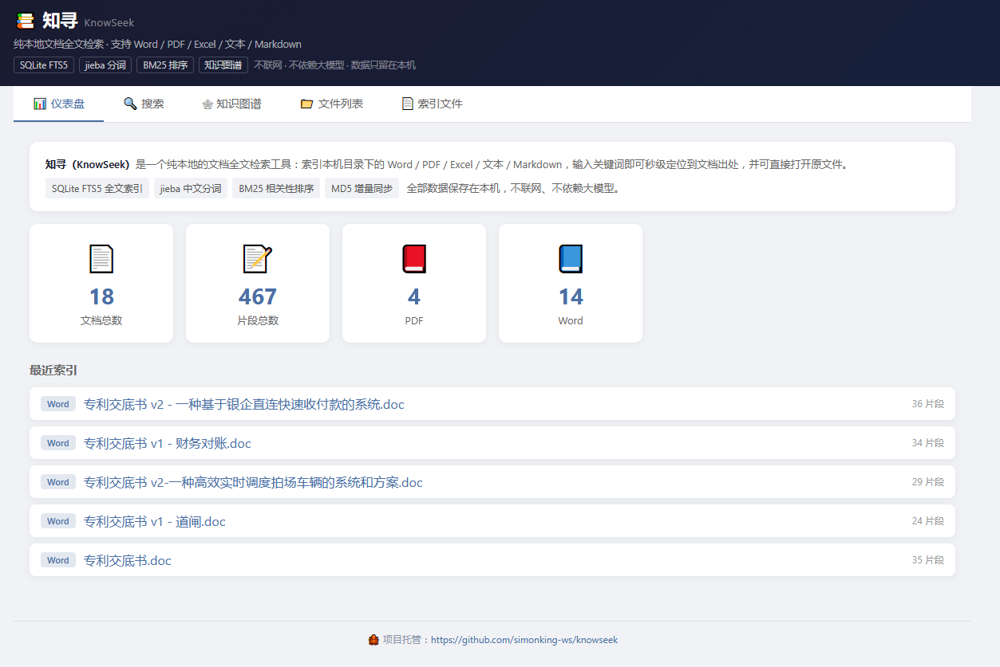
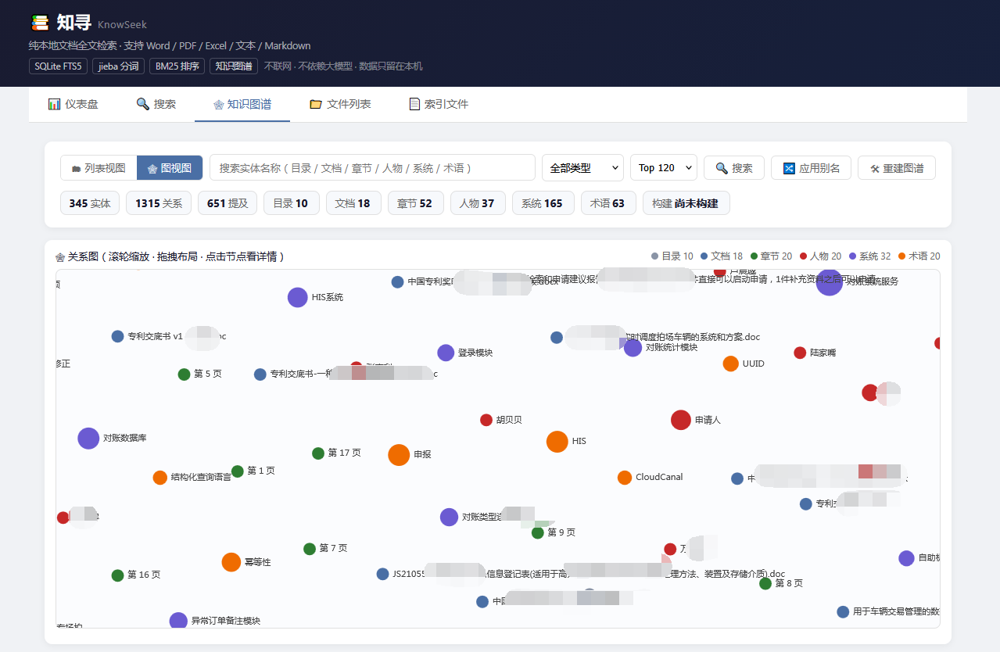
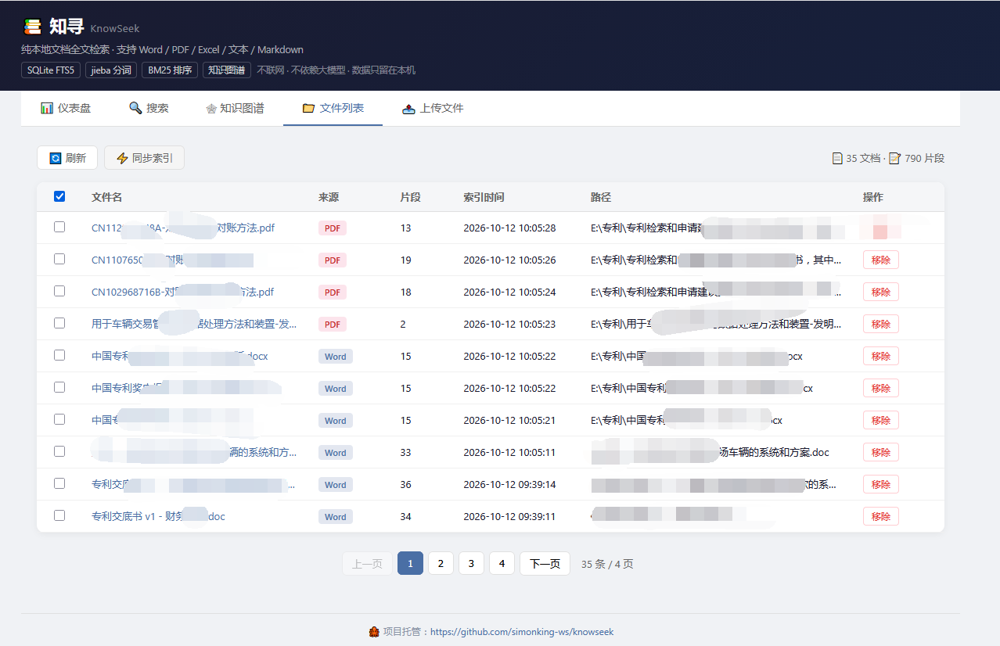
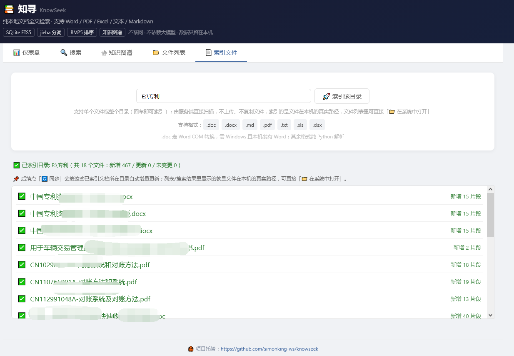
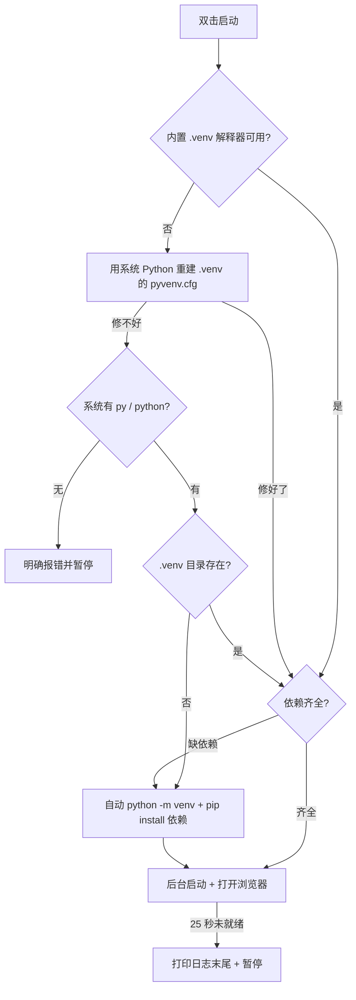

# 🔍 知寻 KnowSeek

> 纯本地知识库：**全文检索 + 知识图谱**，不依赖任何大模型，断网可跑。
>
> 技术栈：SQLite FTS5 + jieba + BM25 + 自建知识图谱 + Flask + 本地 ECharts

---

## ✨ 核心能力

### 检索

| 能力 | 说明 |
|------|------|
| **关键词搜索** | BM25 相关性排序，jieba 搜索引擎模式分词 |
| **关键词高亮** | 命中词黄色 `<mark>` 高亮，大小写不敏感 |
| **定位出处** | 文件路径 + 章节路径 + 段落号/行号，点击查看原文上下文 |
| **多格式** | Word `.docx` / `.doc`、PDF、Excel `.xlsx` / `.xls`、TXT、Markdown |
| **来源过滤** | Word / PDF / Excel / TXT·MD |
| **命中实体** | 搜索结果顶部显示命中的图谱实体 chips，点击直达图谱 |

### 知识图谱

| 能力 | 说明 |
|------|------|
| **L0 结构层** | 目录 → 文档 → 章节 的层级树 |
| **L1 实体层** | 人物 / 系统 / 术语抽取，段落级共现关系 |
| **两种视图** | 列表视图（**默认**，每页 10 条）/ 图视图（力导向、缩放拖拽、点节点看详情） |
| **最短路径** | 任意两实体间 1–6 跳无向路径，显示每段谓词 |
| **别名合并** | 按 `data/kg_alias.json` 收敛重复实体（如「所述对账系统」→「对账系统」），也支持详情面板手动合并 |
| **重建图谱** | 从现有索引重建，**不重新解析文件** |

### 文档管理

| 能力 | 说明 |
|------|------|
| **增量同步** | 扫描目录，MD5 变化才重新索引；`prune` 清理已删除文件 |
| **索引文件 / 目录** | 唯一入口：填本机**单个文件**或**目录**的路径，服务端直接扫描（不上传、不复制文件）；**索引的是文件在本机的真实路径**（可「📁 在系统中打开」），后续「🔄 同步」按已索引文档所在目录持续增量更新（无需在 `config.yaml` 手工配置扫描目录） |
| **单文件索引** | 只索引这一个文件：同步时也不会把它所在目录的其它文件拉进来 |
| **同步保护** | 库里没有任何本机文件/目录的文档，或路径不可达（如移动硬盘未接）时跳过同步，不会把索引误判为"已删除" |
| **文件管理** | 列表查看 / 原文弹窗 / 单条或批量移除 / 打开所在目录 / 下载（**只清索引与图谱，永不删除磁盘原文件**） |
| **清空文档** | `🧹 清空文档`：一次清掉全部索引与图谱，**二次确认**（第二次须输入「清空」二字），**不删除磁盘原文件** |

---

## 🖼️ 界面预览

### 📊 仪表盘
文档总数、片段总数、来源分布一眼看清，下方是最近索引的文件。



### 🔍 搜索
关键词 → BM25 排序；顶部 `🕸 命中实体` chips 可直达图谱，命中词黄色高亮，卡片带来源标签与章节定位。


### 🕸 知识图谱（图视图）
工具栏显示实体 / 关系 / 提及统计与类型图例；力导向布局支持滚轮缩放、拖拽节点、点节点看详情（提及片段 / 共现实体 / 别名 / 最短路径）。



### 📁 文件列表
表格展示来源、片段数、索引时间与文件真实路径，支持勾选批量移除、原文弹窗、打开所在目录。



### 📄 索引文件
填写本机**单个文件**或**目录**的绝对路径 → 「🚀 开始索引」，服务端扫描（不上传、不复制文件），带进度条与逐条结果。



---

## 📁 项目结构

```
knowseek/
├── app/
│   ├── __init__.py          # 包初始化
│   ├── parser.py            # 文档解析（Word/PDF/Excel/TXT/MD → chunks）
│   ├── indexer.py           # SQLite FTS5 索引 + 搜索 + 统计
│   ├── sync.py              # 增量同步（扫描目录 → MD5 对比 → 索引）
│   ├── kg.py                # 知识图谱（结构树 / 实体抽取 / 别名合并 / 最短路径）
│   └── server.py            # Flask 服务 + 全部前端界面（单文件模板）
├── data/
│   ├── knowseek.db             # SQLite 数据库（唯一数据源，首次运行自动创建）
│   ├── kg_terms.txt            # 图谱领域词典（空模板，按需填词）
│   ├── kg_stopwords.txt        # 实体噪声词表（内置通用停用词，文件缺失也能跑）
│   └── kg_alias.json           # 实体别名表（随仓库提供：通用缩写/别称词典，可自行增删）
├── images/                  # README 界面截图
│   ├── dashboard.png        # 仪表盘
│   ├── search.png           # 搜索
│   ├── kg.png               # 知识图谱（图视图）
│   ├── files.png            # 文件列表
│   └── upload.png           # 索引文件
├── static/
│   └── echarts.min.js       # 离线内置 ECharts（不走 CDN）
├── logs/
│   └── knowseek.log         # 运行日志
├── config.yaml              # 配置文件
├── requirements.txt         # Python 依赖
├── run.py                   # 启动入口
├── 启动知寻.bat             # Windows 一键启动（自动选环境 + 自动装依赖）
├── 停止知寻.bat             # Windows 停止服务
├── 重启知寻.bat             # Windows 重启服务
└── 修复环境.bat             # Windows 下载 zip 后的排错脚本（解锁 / 修换行 / 环境自检）
```

---

## 🚀 快速开始

### 方式 A：Windows 双击即用（推荐，不用装 Python）

仓库**自带完整的 `.venv` 运行环境**，所以下载解压后不需要 `pip install` 任何东西。

三步，请严格按顺序做：

1. 下载 zip 后，**先右键 zip → 属性 → 勾选「解除锁定」→ 确定**，再解压
   （不解锁的话，Windows 会把里面的 `python.exe` 当外来程序拦截、杀软也可能直接隔离）
2. 解压到**短路径**，推荐 `C:\knowseek\`
   （`.venv\Lib\site-packages\...` 路径很深，长路径会被 Windows 260 字符限制截断而丢文件）
3. 双击 `启动知寻.bat`，等浏览器自动打开 **http://127.0.0.1:9876**

> **双击没反应 / 一闪而过？** 先双击一次 `修复环境.bat`（自动解锁 + 修复换行符 + 打印环境报告），再重试。
> 仍然不行，看文末的 [排错章节](#排错windows-一键脚本)。

### 方式 B：手动命令行（macOS / Linux / 想用自己的 Python）

#### 1. 安装依赖

```bash
pip install -r requirements.txt
```

> 国内网络建议清华镜像：`pip install -r requirements.txt -i https://pypi.tuna.tsinghua.edu.cn/simple`

#### 2. 配置

编辑 `config.yaml`：

```yaml
# 支持的文件扩展名（.doc 走 Word COM，仅 Windows；.xls 与 .xlsx 同一解析器）
extensions:
  - ".docx"
  - ".doc"
  - ".txt"
  - ".md"
  - ".pdf"
  - ".xlsx"
  - ".xls"

sync_interval: 300   # 增量同步间隔（秒）
max_results: 50      # 搜索结果默认返回条数
port: 9876           # 服务端口

# 自定义词典（可选，一行一个词）
# custom_dict: "data/custom_dict.txt"

# 知识图谱
kg:
  term_dict: "data/kg_terms.txt"      # 领域词典：词 [词频] [词性]
  stopwords: "data/kg_stopwords.txt"  # 噪声词：不会抽成实体
  alias_file: "data/kg_alias.json"    # 别名表：{"规范名": ["别名", ...]}，随仓库提供，可直接改
  min_doc: 2                          # 重建时清理低频实体：出现文档数 < 该值
  min_mention: 3                      #                   且 提及数 < 该值
  topk_edges: 10                      # 每个节点保留的共现边上限
```

#### 3. 启动

```bash
python run.py
```

浏览器访问 **http://127.0.0.1:9876**

---

## 🪟 Windows 脚本说明

| 脚本 | 用途 |
|------|------|
| `启动知寻.bat` | 自动挑环境 → 依赖自检 → 后台启动 + 开浏览器；已在运行则只打开页面 |
| `停止知寻.bat` | 终止占用 9876 端口的进程；未运行时直接提示 |
| `重启知寻.bat` | 先停止 → 等端口释放 → 再启动（改完代码/配置后用这个） |
| `修复环境.bat` | **下载 zip 后双击无效的万能第一步**：解除文件锁定、修复 bat 换行符、打印环境报告 |

`启动知寻.bat` 的环境选择策略（每一条失败都会有明确提示，不会静默退出）：



---

## 🖥️ 界面功能

Tab 顺序：**📊 仪表盘 › 🔍 搜索 › 🕸 知识图谱 › 📁 文件列表 › 📄 索引文件**

### 📊 仪表盘
- 文档总数、片段总数、各来源分类数量
- 点击来源卡片跳转到搜索并自动筛选该类型
- 最近索引文件列表

### 🔍 搜索
- 关键词 → BM25 排序返回结果
- 结果顶部：**🕸 命中实体** chips（带命中次数，点击直达图谱该实体）
- 结果卡片：来源标签、文件名、高亮内容、章节定位、BM25 分数、`🕸 图谱` 直达
- 点击卡片 → 原文弹窗（目标段黄底高亮，前后各 2 段灰色上下文）
- 来源过滤 + 重置按钮 + 分页（每页 10 条）

### 🕸 知识图谱
- **默认列表视图**（每页 10 条），工具栏可切到**图视图**
- 图视图：力导向布局，滚轮缩放、拖拽节点、点击节点看详情（提及片段 / 共现实体 / 别名 / 最短路径）
- 工具栏：类型筛选、Top 60/120、关键词搜索、`🛠 重建图谱`、`🔀 应用别名`
- 路径查询：`🔗 设为起点` + `🎯 设为终点` → `🧭 计算最短路径`

### 📁 文件列表
- 已索引文件（文件名、来源、片段数、索引时间、路径）
- 全选/取消全选、单行勾选高亮、批量移除（都只清索引与图谱，磁盘原文件保留）
- `🧹 清空文档`：第一次弹窗告知范围 → 第二次弹窗须输入「清空」二字
- 点击文件名 → 原文弹窗；分页（每页 10 条）
- 路径列显示文件在本机的真实路径

### 📄 索引文件
- 填写本机**单个文件**或**目录**的绝对路径（回车即可索引）→ 「🚀 开始索引」
- 支持 `.docx` `.doc` `.pdf` `.xlsx` `.xls` `.txt` `.md`（页面会列出当前 `config.yaml` 里生效的格式）
- `.doc` 解析走 Word COM：需 Windows + 本机装有 Word + `pywin32`；未装 Word 时该文件显示为 ❌
- 进度条 + 逐条结果（✅ 新增 / 🔄 更新 / ⏩ 未变更 / ❌ 失败），可随时「⛔ 终止」
- 服务端直接扫描，不上传、不复制文件，原文件始终留在本机
- 单文件索引只针对该文件，后续同步不会牵连同目录的其它文件

---

## 🏗️ 架构原理

```
┌───────────────┐     ┌────────────────┐     ┌──────────────────────┐
│  文档解析      │ ──→ │  jieba 分词     │ ──→ │  SQLite FTS5         │
│  docx/doc/pdf │     │  搜索引擎模式    │     │  BM25 + UNINDEXED 原文│
│  xlsx/txt/md  │     └────────────────┘     └──────────┬───────────┘
└───────────────┘                                        │
                                                         │ SQL
┌───────────────┐                                        │
│  增量同步      │ ←── MD5 对比 ───────────────────────────┘
└───────────────┘                                        │
                                                         │ chunks
┌───────────────┐                            ┌───────────▼───────────┐
│  知识图谱      │ ── 结构树 + 实体共现 ───→  │  kg_* 表（同库）       │
│  jieba posseg │                            │  实体 / 关系 / 提及    │
└───────────────┘                            └───────────┬───────────┘
                                                         │
                                          ┌──────────────▼─────────────┐
                                          │  Flask API + Web UI        │
                                          │  搜索 / 图谱 / 文件管理     │
                                          └────────────────────────────┘
```

### 文档解析

| 格式 | 解析方式 | 切块策略 | 定位信息 |
|------|----------|----------|----------|
| `.docx` | python-docx 按段落 | 每段落 = 1 chunk | 文件路径 + Heading 路径 + 段落序号 |
| `.doc` | pywin32 调 Word COM 转换（仅 Windows） | 同 `.docx` | 同 `.docx` |
| `.pdf` | pdfplumber 按页 | 每页 = 1 chunk | 文件路径 + "第 N 页" + 页号 |
| `.xlsx` | openpyxl 按 Sheet | 每行 = 1 chunk | 文件路径 + Sheet 名 + 行号 |
| `.txt` / `.md` | 逐行读取 | 每 3 行 = 1 chunk | 文件路径 + 行号范围 |

### 搜索流程

1. 关键词 → jieba `cut_for_search` 分词
2. 构建 FTS5 MATCH 表达式（AND 语义）
3. SQLite `bm25()` 排序
4. Python 层高亮（`file_path` 同样参与显示）
5. 按结果片段反查 `kg_mentions`，聚出**命中实体**一并返回
6. 点击结果 → 按 `file_path + para_index` 取目标 chunk + 前后各 2 段（毫秒级）

### 图谱构建

1. **L0 结构层**：目录链 → 文档节点 → 章节树（`contains` 边）
2. **实体挂载**：实体通过 `mentions` 边挂到所在章节/文档，保证图谱连通
3. **L1 实体层**：自定义词典 + jieba 词性标注抽取 人物 / 系统 / 术语，段落内共现建 `related_to` 边（权重累加，按 `topk_edges` 裁剪）
4. **降噪**：别名映射 + 句首粘连词剥离（`所述 / 一种 / 通过 …`）+ 噪声词表

---

## 💾 数据存储说明

- **`data/knowseek.db` 是唯一数据源**（索引 + 图谱都在里面）。备份/迁移只需拷贝这一个文件。
- **只索引本机文件 / 目录**：不上传、不复制文件，库里记的是文件在本机的真实路径，列表里可「📁 在系统中打开」；原文件始终在磁盘，改动后点同步按 MD5 重新解析。
- 全量同步（`prune`）会清理"扫描不到的文档"；早期版本上传产生的 `upload://` 记录（若有）会被跳过，不会误删。
- **知寻不会删除磁盘上的任何原文件**：单条移除 / 批量移除 / `🧹 清空文档` 清的都是数据库（`documents` / `chunks_fts` / `kg_*`），原文件始终留在磁盘上；要真正删文件请用系统文件管理器（列表里有「📁 在系统中打开」）。
- `🧹 清空文档`后库里不再有文档，「⚡ 同步索引」的扫描目录（由已索引文档路径反推）也随之为空，不会把旧目录重新索引回来。
- **首次使用 / 全新 clone 时的 `data/` 状态**：
  - `knowseek.db` — **不存在**，首次运行自动建表生成
  - `kg_terms.txt` — 空模板（只有注释），按需填领域词
  - `kg_stopwords.txt` — 通用停用词，可留；**删掉也能跑**（代码内置 `_STOP` / `_EN_STOP` 兜底）
  - `kg_alias.json` — **随仓库提供**，内置 AI/数据、中间件、开发框架、厂商等通用别名；使用过程中发现重复实体继续往里加即可（涉及业务实体名时，建议另存 `kg_alias.local.json` 并忽略）

---

## 🔌 主要 API

| 方法 | 路径 | 说明 |
|------|------|------|
| GET | `/api/search` | 搜索（含 `entities` 命中实体） |
| GET | `/api/stats` | 文档数 / 片段数 / 来源分布 |
| GET | `/api/file_content` | 取原文（查库，不重新解析） |
| GET/DELETE | `/api/files` | 文件列表 / 移除索引 |
| DELETE | `/api/files/batch` | 批量移除 |
| POST | `/api/files/clear` | 清空全部索引 + 图谱（需 `confirm:"CLEAR"`，不删原文件） |
| POST | `/api/sync` | 全量同步（prune） |
| POST | `/api/scan_preview` | 目录预检（只统计不入库） |
| POST | `/api/index_path` | 增量索引某个文件或目录（prune=false） |
| POST | `/api/open_file` | 打开/定位到本地文件 |
| GET | `/api/kg/stats` | 图谱统计 |
| GET | `/api/kg/entities` | 实体列表（分页） |
| GET | `/api/kg/graph` | 图数据（top / type / q） |
| GET | `/api/kg/node/<id>` | 实体详情（提及、共现、别名） |
| GET | `/api/kg/neighbors/<id>` | 邻居 |
| GET | `/api/kg/path` | 两实体最短路径 |
| POST | `/api/kg/merge` | 合并实体 |
| POST | `/api/kg/apply_alias` | 按别名表批量合并 |
| POST | `/api/kg/rebuild` | 重建图谱（不重新解析文件） |

---

## 📦 依赖清单

| 依赖 | 用途 |
|------|------|
| jieba | 中文分词 + 词性标注 |
| python-docx | Word `.docx` 解析 |
| pdfplumber | PDF 解析 |
| openpyxl | Excel 解析 |
| flask | Web 服务 |
| PyYAML | 配置文件解析 |
| pywin32 | `.doc` 解析（仅 Windows） |

---

## 📊 性能参考（预估）

> 新项目启动后 `data/knowseek.db` 是空的（0 文档 / 0 片段），下表为**参考量级**，实际会随文档数量、篇幅、格式和机器配置浮动；自己库里的真实数字看「📊 仪表盘」。

| 指标 | 参考值 |
|------|--------|
| 首次索引速度 | 约 100–400 篇/分钟（实测：32 KB 的 `.docx` ≈ 0.14 s/篇，800 KB 的 `.pdf` ≈ 0.8 s/篇） |
| 增量同步 | 只重新解析 MD5 变化过的文件，通常秒级完成 |
| 搜索响应 | 1 万篇以内 < 1 秒（分词 + FTS5 + BM25 + 高亮） |
| 原文查看 | < 100 ms（直接查 SQLite，不重新解析文件） |
| 图谱重建 | 数百篇文档约 10–60 秒（读库重建，同样不重新解析文件） |
| 内存占用 | 常驻 < 100 MB（PDF 解析瞬间会高一些） |
| 适用规模 | 1 万篇文档以内 |

图谱越用越准：往 `data/kg_terms.txt` 加领域词、往 `kg_stopwords.txt` 加噪声词、往 `kg_alias.json` 加别名，然后 `🔀 应用别名` 或 `🛠 重建图谱` 即可生效。

---

## 📝 其它说明

- 搜索页的来源过滤器里预留了 **飞书 / 语雀 / Jenkins** 标签，但对应 Connector 尚未接入，当前实际数据源只有本地文件。
- 图谱为自建实现（非 GraphRAG），**全程离线、不接入任何大模型**，也没有任何联网调用。

---

## 排错（Windows 一键脚本）

> 双击 bat **没反应**时，先把 `启动知寻.bat` 拖到 cmd 窗口里回车运行（或在目录地址栏输入 `cmd` 回车后敲 `启动知寻.bat`），
> 这样窗口不会自动关闭，能看到真实原因。更快的方式是直接双击 **`修复环境.bat`**。

| 现象 | 原因 | 解决办法 |
|------|------|----------|
| 双击后窗口一闪而过 | 脚本末尾缺 `pause`，或 `.venv` 不存在导致 `start` 立刻失败 | 新版脚本已全部改成 `pause` 兜底；确认已拉取最新 bat |
| 窗口里中文全是乱码 | bat 是 UTF-8，cmd 默认 GBK 代码页 | 新版脚本第一行就是 `chcp 65001`，正常不应再出现 |
| 提示「No usable python runtime」 | zip 里没解压出 `.venv` | 重新解压到 `C:\knowseek\`；或改用方式 B 手动安装依赖 |
| 提示 python.exe 找不到 DLL / 版本不对 | `.venv\pyvenv.cfg` 记录了**创建者机器上**的 Python 安装路径 | 脚本会自动尝试修复；修复失败会回落到系统 Python 重建 venv |
| 卡在等待就绪，最后打印日志 | Flask 起不来，99% 是依赖缺失 | 看 `logs\knowseek.log` 末尾；或删掉 `.venv` 重来一次自动安装 |
| 端口 9876 被占用 | 上一个实例没关干净 | 双击 `停止知寻.bat`，或改 `config.yaml` 里的 `port` |
| 杀软报毒 / 自动删除文件 | `.venv` 里 30 个 `.exe` 被误判 | 恢复隔离文件；解压前对 zip 右键 → 属性 → **解除锁定** |
| 提示路径太长 / 解压不完整 | Windows 260 字符路径限制 | 解压到短路径，如 `C:\knowseek\` |

以上都排查不掉时，先看 `logs\knowseek.log`——后台服务的所有输出都在那里。

---

## 📦 发布须知（给维护者）

`双击即用`依赖"把 `.venv` 原样提交进仓库"，推之前请确认三件事：

```bash
# 1) 确认 .venv 真的被 Git 跟踪了（应当有上万行输出）
git ls-files | grep "^.venv/" | wc -l

# 2) 若上面是 0 —— 强制把整个虚拟环境加入版本控制
git add -f .venv

# 3) 让新增的 *.bat text eol=crlf 规则生效到已入库文件（关键！否则 zip 里仍是 LF）
git add --renormalize .
git status
```

`.gitattributes` 里 `*.bat text eol=crlf` 决定 GitHub 导出 zip 时 bat 的换行符。
**改完 `.gitattributes` 后必须跑一次 `git add --renormalize .`**，否则只在本地工作区里是 CRLF、仓库和 zip 里仍是 LF，cmd 会解析失败。

发布后拿 `Source code (zip)` 自检一次：解压 → 看 bat 用记事本打开右下角是否显示 **CRLF** → 双击。
